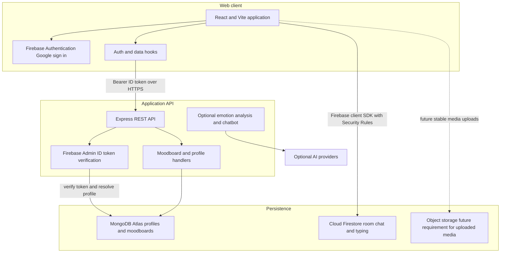

# EmoteModer Architecture and Product Design

This document reflects the application source after the Firebase bearer-token migration. It is the current implementation map, not a claim that external services are already configured for production.

## Product shape

EmoteModer combines personal moodboards, a public moodboard gallery, six public live mood rooms, a static no-account demo, and optional AI-assisted reflection. It does not currently include direct messages, collaborative boards, stories, or ephemeral moments. Keep the core social experience usable without an AI provider. AI output is advisory and must never become the source of truth for a user's mood or identity.

## Current architecture

### Authentication boundary

The browser signs in with Google through Firebase Authentication. Protected API requests carry a Firebase ID token in `Authorization: Bearer`. Express verifies the token with Firebase Admin and resolves a Mongo profile using the Firebase UID, linking a prior profile by verified email when appropriate. Firestore rules scope user-owned documents to the signed-in Firebase UID. Do not use cross-site session cookies or expose Firebase Admin credentials to the browser.

### Service responsibilities

| Concern | Source of truth | Access path |
| --- | --- | --- |
| Identity and sign-in | Firebase Authentication | Firebase client SDK; verified by Express Admin SDK |
| Profile and moodboards | MongoDB | Express API only |
| Room chat and typing | Firestore | Firebase client SDK under Firestore Security Rules |
| AI emotion reflection | Optional Hugging Face provider with local fallback | Express API; optional provider key stays server-side |
| Modobot chat | Kilo free route with local fallback | Express API; no browser-to-provider connection |
| Media assets | Not fully implemented | Add Firebase Storage or equivalent before persisting user uploads |

## Data design guidance

### MongoDB

`User` has a Mongo `_id`, unique sparse `firebaseUid`, legacy/compatibility `googleId`, email, display name, photo, and timestamps. `MoodBoard` stores an owner identity, title, visibility, and typed content items. Enforce ownership in every handler. Add query indexes matching owner/public listing and newest-first access; validate and cap nested item payloads at the API boundary. Treat profile linking as a migration-sensitive operation and avoid linking on an unverified email.

Current board shape: legacy-compatible owner `googleId`, `title`, optional `description`, selected `mood`, `isPublic`, and `items[]` with `image`, `text`, or `color` types plus optional position. Each document also has timestamps and compact `emotionAnalysis` metadata. Store durable HTTPS image URLs only; never browser blob URLs or base64 image payloads.

### Firestore

- `chatRooms/{roomId}/messages/{messageId}`: sender UID/name/photo, text or supported mood, server timestamp, and retention metadata. Messages cannot be edited.
- `chatRooms/{roomId}/typing/{uid}`: sender UID/name, server timestamp, and retention metadata. The client removes indicators when a person stops or leaves.

Rules verify a verified Google sign-in, restrict IDs to the six shared rooms, validate allowed fields, and prevent users from writing another user's identity. There are no custom Firestore composite indexes at present. Firestore parent deletion does not automatically remove subcollections, so define deletion behavior before a public launch.

## AI and ML approach

The current emotion analysis/provider integration is optional and has a deterministic local fallback. Keep user-authored mood selection primary. A sensible staged path is: (1) rules/lexicon baseline and confidence/abstention, (2) provider-backed classification behind a server API with consent and redaction, (3) evaluate a small open model only when there is representative, consented data and a measured quality/privacy benefit. Do not train on private chats without explicit opt-in. Log model/provider/version and coarse latency/error metrics, not raw conversation text. Avoid emotion claims framed as diagnosis.

## Frontend design system

Use shared semantic tokens for color, typography, spacing, radius, borders, elevation, and motion. Light and dark modes must share the same hierarchy and contrast targets. Soft neubrutalism belongs in controls and cards through clear outlines, offset shadows, and press states; keep reading surfaces calm and preserve familiar navigation patterns. Prefer accessible inline SVG icon components over emoji as interface chrome. Support keyboard focus, reduced motion, loading/empty/error states, responsive layouts, and usable touch targets. Use spring-like transitions sparingly and honor `prefers-reduced-motion`.

## Runtime configuration

### Frontend (`frontend/.env`)

- `VITE_BACKEND_URL`: optional API origin for a separately hosted frontend; local development uses the Vite proxy.
- `VITE_FIREBASE_API_KEY`, `VITE_FIREBASE_AUTH_DOMAIN`, `VITE_FIREBASE_PROJECT_ID`, `VITE_FIREBASE_STORAGE_BUCKET`, `VITE_FIREBASE_MESSAGING_SENDER_ID`, `VITE_FIREBASE_APP_ID`: public Firebase web app configuration. Restrict API key usage where supported and enforce access with Security Rules.

### Backend (`backend/.env`)

- `MONGO_URI`: valid Mongo connection string.
- `FRONTEND_URL`: exact allowed web origin for CORS.
- `FIREBASE_PROJECT_ID`, `FIREBASE_CLIENT_EMAIL`, `FIREBASE_PRIVATE_KEY`: Firebase Admin service-account credentials. Keep private key only in backend environment/secret manager.
- `HUGGING_FACE_API_KEY` and `HUGGING_FACE_MODEL`: optional moodboard-classification configuration; omit both to use the local lexicon.

Never put provider or Admin credentials in `VITE_` variables.

## Free-tier setup path

1. Create a Firebase project, enable Google in Authentication, register the web app, create Firestore, and deploy the checked-in rules/indexes.
2. Generate a Firebase Admin service account key and configure the three backend Admin variables in local secrets or the API host secret store.
3. Create an Atlas Free cluster, allow the development IP, create a database user, and use its generated connection string as `MONGO_URI`.
4. Run `npm run dev`; the local Vite proxy handles API calls, so no `VITE_BACKEND_URL` is needed.
5. For a first hosted demo, Firebase Hosting can serve the built frontend and a small API host can serve Express. Configure `FRONTEND_URL` to the exact Hosting origin and `VITE_BACKEND_URL` to the deployed API URL.
6. Add object storage before enabling cross-device image uploads. Current browser object URLs are temporary and cannot be shared.

Use `npm run check:config` to inspect your own local setup without printing secrets. This document intentionally makes no claim about the validity of a developer's private environment.

## Operational gaps to resolve before production

- Set and verify Mongo Atlas connection string, network access, and persistence; do not rely on process memory as durable storage.
- Configure Firebase Google provider, authorized domains, Admin credentials, restrictive Firestore rules, and production indexes.
- Establish media upload limits, malware/type validation, ownership, deletion, and storage lifecycle.
- Expand request validation and add structured redacted logs, error monitoring, and API readiness checks.
- The current per-user limiter protects board creation and AI endpoints in one process. Replace its in-memory store with a shared limiter before running multiple API instances.
- Confirm CORS origins and HTTPS deployment settings.
- Define account export/deletion and data retention, especially for Firestore subcollections.
- Add automated coverage for token verification, account linking, board ownership/visibility, Firestore rules, and AI fallback before production launch.

## Related implementation files

- API entry and auth: `backend/index.js`, `backend/middleware/requireAuth.js`, `backend/services/firebaseAdmin.js`
- Mongo schemas: `backend/models/User.js`, `backend/models/MoodBoard.js`
- Firestore client/rules/indexes: `frontend/src/firebase.js`, `firebase/firestore.rules`, `firebase/firestore.indexes.json`
- API token client: `frontend/src/lib/api.js`, `frontend/src/hooks/useAuth.jsx`