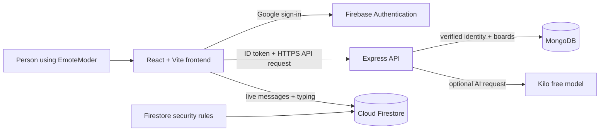
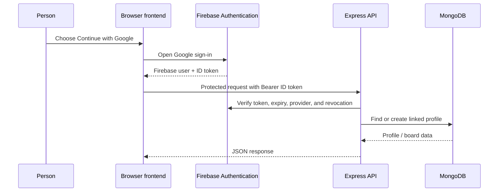
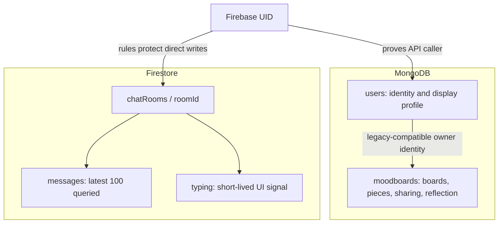
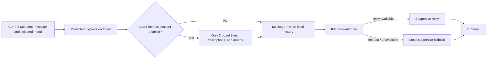

# EmoteModer technical guide

This guide explains the current application in everyday language. It describes what is actually in the repository-not an aspirational future design.

## The big picture

```text
Person in browser
  │
  ├─ React + Vite frontend ── Google sign-in ──> Firebase Authentication
  │          │                                      │
  │          ├─ personal boards / AI ─ ID token ─> Express API ─> MongoDB
  │          │                                      │
  │          └─ community chat ──────────────────> Firestore
  │                                                   ▲
  └──────────────── Firestore security rules ─────────┘
```

The same picture in an editable diagram:



Two databases are intentional:

- **MongoDB** is good for a moodboard because each board is one flexible, nested document with many different item types. It also supports the personal-board and public-gallery queries efficiently.
- **Firestore** is used only for the small, fast-changing part: live chat messages and typing indicators. Its browser SDK provides real-time updates, and its rules can protect direct browser writes without routing every keystroke through Express.

Firebase Authentication is the identity bridge. The same Google sign-in creates a Firebase user for chat and an authenticated identity that Express verifies before it creates or reads MongoDB records.

## What happens when someone uses the app?

### 1. They open the site

React Router shows a public page at `/`, `/login`, `/gallery`, or `/demo`. The authentication provider listens to Firebase. Until Firebase has answered, the app shows a loading state instead of guessing whether the person is signed in.

The demo at `/demo` is deliberately separate: sample boards and messages are static React state. It makes no Firebase, MongoDB, Firestore, or AI request.

### 2. They sign in with Google

1. The frontend opens Firebase's Google sign-in popup.
2. Firebase returns a signed-in browser user and an ID token.
3. The frontend uses that ID token only when it calls a protected `/api/...` endpoint.
4. Express verifies the token with Firebase Admin, including expiry, revocation, Google provider, and verified-email requirements.
5. Express finds or creates the corresponding MongoDB user record. It can safely link an old record by its Google provider ID or verified email without allowing two Firebase accounts to claim it.

The browser never sends an arbitrary `userId` that the backend trusts. The backend derives ownership from the verified token.



### 3. They create a moodboard

The dashboard calls `POST /api/moodboards` with a title, optional description, selected mood, sharing flag, and up to 100 items. The server:

1. verifies the caller;
2. rate-limits board creation to 10 requests per minute per API process;
3. validates lengths, item types, positions, colours, and HTTPS image links;
4. sets the owner itself, rather than accepting an owner from the browser;
5. writes the board to MongoDB; and
6. adds an optional compact emotion reflection.

The person's chosen mood is still the primary UX signal. The reflection is helpful metadata, not a decision about how they feel.

### 4. They join a mood room

The chat screen uses the Firebase browser SDK directly. It subscribes to the latest 100 messages in one of six shared rooms: `happy`, `sad`, `angry`, `fear`, `disgust`, or `surprise`.

Firestore rules require a verified Google account, restrict rooms to that list, require the sender UID/name/photo to match Firebase claims, prevent message edits, and allow deletion only by the sender. Typing indicators are short-lived, throttled client-side, and removed when a person leaves the room.

This is community chat, not a meeting product. The project does **not** contain private rooms, capacity reservations, video calls, or meeting-room pools.

### 5. They ask Modobot for help

The floating Modobot sends the current message, at most eight recent local chat turns, and the selected UI mood to `POST /api/chatbot`.

The backend calls Kilo's OpenAI-compatible free route with model `kilo-auto/free`. The browser does not call Kilo directly. A request is limited to 20 per minute and 200 per day per signed-in account, per API process. If Kilo is unavailable, the backend returns a short local supportive reply instead, so the feature remains demonstrable without a provider key.

The optional “Use a summary of my 3 latest moodboards” setting is off by default and saved in that browser's local storage. When on, the backend loads only each board's title, description, and selected mood. It sends that compact summary with the prompt; it does not send board items, image URLs, or the user's whole database.

The app does not persist the Modobot conversation. Kilo is an external service, so opt-in context and the current prompt leave your backend for that request. Do not position Modobot as therapy, crisis support, or a diagnostic tool.

## Data model

### MongoDB: `users`

| Field | Why it exists |
| --- | --- |
| `firebaseUid` | The verified Firebase identity used by the API. Unique when present. |
| `googleId` | Stable Google provider ID retained for existing board ownership. Unique and immutable. |
| `displayName`, `email`, `photo` | Small profile display fields copied from verified Firebase claims. |
| `createdAt`, `updatedAt` | Operational timestamps. |

The user lookup order is Firebase UID, Google provider ID, then verified email. That order avoids breaking pre-existing boards while preventing an already-claimed Firebase UID from being overwritten.

### MongoDB: `moodboards`

| Field | Why it exists |
| --- | --- |
| `userId` | Board owner; set only on the server. |
| `title`, `description`, `mood` | The human-facing board information. |
| `isPublic` | Opt-in visibility in the gallery. |
| `items` | Board pieces: text, a six-digit colour, or a durable HTTPS image URL with position. |
| `emotionAnalysis` | Optional cached label, score, model name, and time. |
| `createdAt`, `updatedAt` | Sorting and pagination fields. |

Indexes support personal boards by `(userId, updatedAt, _id)`, the gallery by `(isPublic, updatedAt, _id)`, and profile lookup by normalized email. Board listings use an opaque `(updatedAt, _id)` cursor instead of an unbounded offset.

### Firestore: chat

```text
chatRooms/{roomId}/messages/{messageId}
chatRooms/{roomId}/typing/{firebaseUid}
```

Messages contain sender identity, text or mood payload, server timestamp, and `expiresAt`. Typing records contain the sender identity, timestamp, and `expiresAt`. `expiresAt` is future-retention metadata only; managed Firestore TTL is not enabled on Spark because TTL deletes require billing.



## AI and emotion recognition

There are two separate features:

1. **Moodboard/text emotion reflection:** `POST /api/analyze-emotion` and board creation use `sentimentAnalysis`. If `HUGGING_FACE_API_KEY` is set privately on the backend, it may use the configured Hugging Face classification model. Without it, or on failure, it uses the local keyword lexicon. Results map to the seven app labels: happy, sad, angry, fear, disgust, surprise, and neutral.
2. **Modobot conversation:** Kilo's `kilo-auto/free` endpoint produces a short supportive reply. A local reply is used if the provider request fails.

Neither score is a clinical confidence level or a fact about a person. Treat it as a lightweight product interaction. If a future product needs stronger accuracy, build a consented evaluation dataset and compare precision/recall per emotion before changing models.



## Frontend route map

| Route | Access | Screen |
| --- | --- | --- |
| `/` | Public | Landing page; redirects signed-in people to `/dashboard`. |
| `/login` | Public | Google sign-in; returns people to their intended protected page. |
| `/demo` | Public | Fully static walkthrough. |
| `/gallery` | Public | Public moodboard feed. |
| `/dashboard` | Signed-in | Personal boards and board composer. |
| `/chat` | Signed-in | Room picker and real-time chat. |
| `/profile` | Signed-in | Account profile. |
| any other path | Public or signed-in | Redirects to `/` or `/dashboard`. |

## Backend route map

See the full request and response details in the [API reference](api-reference.md). In short, `/api/user`, personal board operations, emotion analysis, and Modobot require bearer authentication. `/api/moodboards/public` and `/api/health` are public.

## Important limits and non-features

- Board requests and AI requests use in-memory per-process rate limits. They reset if the process restarts and are not global across multiple backend replicas.
- Direct Firestore chat writes are protected by rules, but large-scale abuse protection and moderation are still deployment work.
- Images are links, not uploaded files. A future upload feature needs object storage, content validation, and retention design.
- Firestore chat has no automatic deletion on the free plan. Monitor free-tier usage and manually clean demo data if needed.
- Environment values and free-tier policies change. The setup guides explain where to configure them; consult provider pricing pages before a public launch.

## Verification and deployment checklist

1. `npm run check:config`
2. `npm test`
3. `npm run lint --prefix frontend`
4. `npm run build`
5. Install Java plus Firebase CLI, then run `npm run test:rules`.
6. Deploy `firebase/firestore.rules` with `firebase deploy --only firestore` to the same Firebase project as the browser app.
7. Confirm Google sign-in, creating/deleting a private board, public gallery visibility, message send/delete, and Modobot fallback in the deployed environment.

The [architecture review](architecture-review.md) records production risks and decisions; the [API reference](api-reference.md) is the source of truth for callers.
